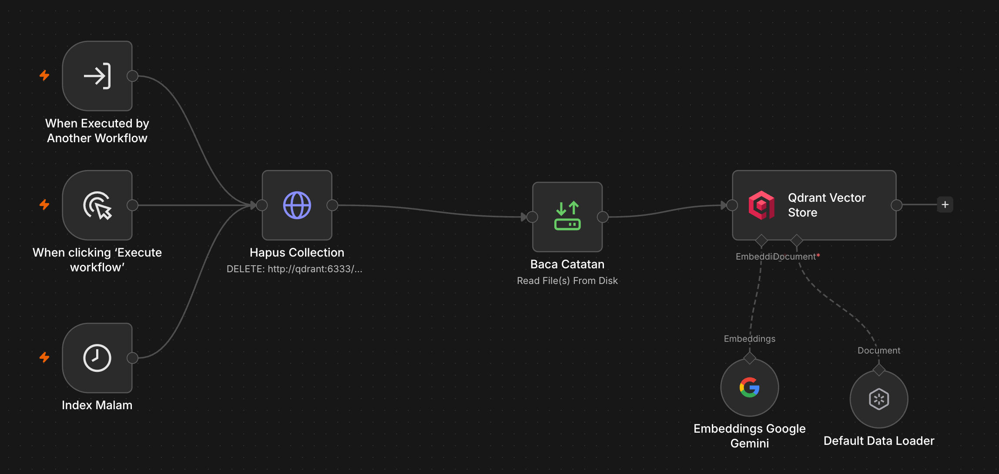
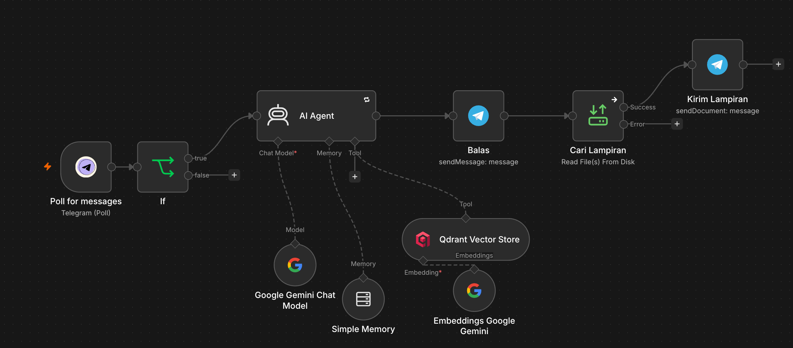

# Tanya Catatanku - a RAG chatbot over my own notes (n8n)

A Telegram bot that answers questions using my personal Obsidian notes as the only source of truth, and cites the note each answer came from.

> Companion project: [Second Brain Intake](../n8n-second-brain) is the ingest side that creates the notes retrieved here. Both share the `Catatan ke Vector Store` ingest sub-workflow.

## Problem

After a few months of note-taking the vault is large enough that keyword search stops helping: the answer exists somewhere, but finding it means remembering which note contains it. A general chatbot cannot help either, because the notes never left my machine.

## Architecture

Two workflows, deliberately separate.

**1. Ingest - Catatan ke Vector Store**

- Reads every `.md` file in `/vault/2nd-brain/notes`.
- The Default Data Loader splits each note into chunks (1000 characters, 200 overlap) and stamps the filename into a `sumber` metadata field.
- Gemini embeddings convert each chunk to a 3072-dimension vector.
- Qdrant stores them in the `catatan` collection.
- Runs on a schedule and when the intake workflow calls it, so a new note becomes searchable without a manual re-index.

**2. Agent - Tanya Catatanku**

- Telegram poll receives the question.
- An AI Agent with Gemini as the chat model and Qdrant in _retrieve as tool_ mode searches the collection.
- The system prompt requires the answer to end with `Sumber: <note>.md` and forbids inventing details.
- A Code node reads that citation, finds the matching attachment, and the bot replies with the answer and the original file.

## Results

- **16 vectors** in collection `catatan`, 3072 dimensions.
- Answers always carry the source filename, so every claim can be checked against the note.
- Separate workflows keep ingestion cheap: a new note re-indexes one file, not the whole vault.

## Stack

n8n 2.39.8, Qdrant (Docker), Google Gemini (chat + embeddings), Telegram Bot API, Obsidian vault mount.

## Import

1. Download `catatan-ke-vector-store.json` and `tanya-catatanku.json`.
2. Start Qdrant, bound to localhost only. If Docker containers on your host cannot resolve DNS, add a `dns:` block to the compose service.
3. Import both workflows. Add a Gemini credential and a Telegram Bot credential.
4. In the ingest workflow, check the Qdrant collection name and the vault path.
5. Run the ingest workflow once, then confirm `points_count` is above zero.
6. Publish the agent workflow and ask it a question about a note you know.

## What I learned

- **A vector store node needs its embedding sub-node in every mode**, not only on insert. Retrieval embeds the incoming question too, and an empty embedding slot stops the run with a message that already says exactly that.
- **Changing the embedding model means deleting the collection.** Vector dimensions differ between models, so half-old, half-new vectors in one collection silently breaks search.
- **Retrieval is only as good as the note it retrieves.** A note that says "there were three additional points" without listing them can never be answered, no matter how good the prompt is. The intake prompt now enumerates list items and forbids evaluative adjectives the source did not contain.
- **LangChain keeps `source: blob` next to custom metadata**, so the model cites `blob` unless the prompt names the metadata field explicitly.
